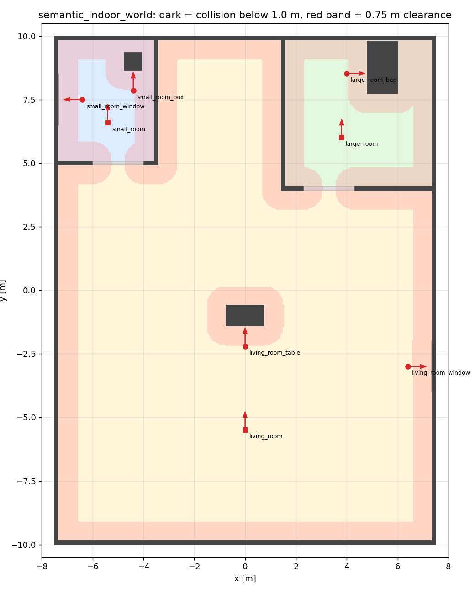

# semantic_indoor_world

ROS 2 Humble + Gazebo Classic 11용 15 m × 20 m 실내 world(`worlds/my_map.world`)와,
LLM 기반 Semantic Navigation에 쓸 **Semantic Map**(`config/semantic_map.yaml`)입니다.

- LLM은 **Target ID만 고르고**(예: `large_room_bed`), 좌표는 `semantic_map_loader.py`가 YAML에서 조회합니다.
- world와 YAML은 **같은 배치 데이터(`scripts/world_layout.py`)에서 생성**되므로 좌표가 따로 놀 수 없습니다.
- `validate_semantic_map.py`가 생성된 `.world` 파일을 직접 읽어 YAML과의 일치, 안전 이격거리, 경로 연결성을 검증합니다.
- 이번 단계에는 로봇, Nav2, LLM이 포함되지 않습니다.



## 좌표계와 배치

건물 중심이 원점, x = 동(15 m), y = 북(20 m), z = 위. 단위는 m, rad. 외벽(두께 0.15 m, 높이 2.7 m)은
15 × 20 m 외곽선 **안쪽**에 있어서, 실내 바닥은 x ∈ [-7.35, 7.35], y ∈ [-9.85, 9.85]입니다.

| 공간·객체 | 위치 | 크기 / 비고 |
|---|---|---|
| 작은 방 `small_room` | 좌측 상단, 벽 중심선 x -7.5~-3.5, y 5~10 | 4 × 5 m (내부 바닥 3.78 × 4.78 m) |
| 큰 방 `large_room` | 우측 상단, 벽 중심선 x 1.5~7.5, y 4~10 | 6 × 6 m (내부 바닥 5.78 × 5.78 m) |
| 거실 `living_room` | 나머지 전체 (두 방 사이 상단 공간 포함) | 별도 복도 없음 |
| 작은 방 출입구 | 작은 방 남쪽 벽, x -6.0~-4.0 | 폭 2.0 m, 높이 2.1 m |
| 큰 방 출입구 | 큰 방 남쪽 벽, x 2.3~4.3 | 폭 2.0 m, 높이 2.1 m |
| `small_room_box` | (-4.4, 9.0) | 0.7 × 0.7 × 0.7 m Box |
| `large_room_bed` | (5.4, 8.72), 헤드보드가 북쪽 벽 쪽 | 1.2 × 2.0 m 프레임 + 매트리스 + 베개 + 헤드보드 |
| `living_room_table` | (0.0, -1.0) | 상판 1.5 × 0.8 m, 높이 0.75 m, 다리 4개 |
| `small_room_window` | 서쪽 외벽, y 6.5~8.5 | 폭 2.0 m, 하단 0.9 m, 높이 1.2 m |
| `living_room_window` | 동쪽 외벽, y -4.0~-2.0 | 폭 2.0 m, 하단 0.9 m, 높이 1.2 m |

- 출입구는 최소 요구폭(1.2 m)보다 넓은 2.0 m로 잡았습니다. 경로 연결성 검증에서 장애물을 0.75 m씩 확장하기 때문에,
  1.5 m 이하의 문은 검증상 통과할 수 없는 폭이 되기 때문입니다.
- 창문은 **외벽을 실제로 뚫은 개구부**입니다. 개구부 아래(0~0.9 m)와 위(2.1~2.7 m)에만 벽이 있고,
  그 사이에 프레임(Box 5개)과 반투명 유리(두께 0.01 m Box, 투명도 0.65)가 있습니다. 유리에도 Collision이 있어서 지나갈 수 없습니다.
- 모든 벽·가구·창문은 SDF 기본 Box로 만들었고, 외부 메시나 `model://` include가 없습니다(바닥과 조명도 world 안에 직접 정의).
- 물리 스텝은 0.002 s입니다. RUBI 컨트롤러 플러그인이 이 값을 요구하므로 같은 환경에 RUBI를 넣을 수 있습니다.

## Semantic Map

```yaml
objects:
  large_room_bed:
    name: "Bed"
    room: large_room
    aliases: ["침대", "bed"]
    object_pose:       # Gazebo world에서 모델의 실제 pose (공간이면 기준점)
      {x: 5.4, y: 8.72, z: 0.0, yaw: 0.0}
    navigation_goal:   # Nav2에 보낼 목표 (x, y, yaw)
      {x: 4.0, y: 8.52, yaw: 0.0}
```

- **`object_pose`**: Gazebo 모델의 실제 pose(`<model><pose>`)입니다. 방은 내부 바닥 중심, 거실은 바닥 다각형의 무게중심입니다.
  거실 기준점(-0.21, -1.64)은 테이블 바로 남쪽이라 그대로 목표로 쓰면 안 됩니다. 이동은 `navigation_goal`을 쓰세요.
- **`navigation_goal`**: 로봇이 실제로 가야 할 위치와 방향입니다. 객체는 가장 가까운 Collision 면에서 0.8 m 떨어진 곳에서 객체를 바라보고,
  창문은 실내 쪽 0.95 m 거리에서 창문을 바라봅니다.
- 방에는 바닥 영역 `region`(다각형), 문 정보는 `doors`, 로봇 생성 권장 위치는 `robot_spawn`에 있습니다.

| Target | object_pose (x, y) | navigation_goal (x, y, yaw) | 장애물까지 거리 |
|---|---|---|---|
| small_room | (-5.46, 7.46) | (-5.40, 6.60, π/2) | 1.53 m |
| large_room | (4.46, 6.96) | (3.80, 6.00, π/2) | 1.73 m |
| living_room | (-0.21, -1.64) | (0.00, -5.50, π/2) | 3.70 m |
| small_room_box | (-4.40, 9.00) | (-4.40, 7.85, π/2) | 0.80 m |
| large_room_bed | (5.40, 8.72) | (4.00, 8.52, 0) | 0.80 m |
| living_room_table | (0.00, -1.00) | (0.00, -2.20, π/2) | 0.80 m |
| small_room_window | (-7.425, 7.50) | (-6.40, 7.50, π) | 0.95 m |
| living_room_window | (7.425, -3.00) | (6.40, -3.00, 0) | 0.95 m |

### 안전 이격거리

```yaml
navigation_config:
  robot_radius: 0.25
  min_goal_clearance: 0.5
  required_obstacle_distance: 0.75   # = robot_radius + min_goal_clearance
  obstacle_max_height: 1.0
```

- 거리는 **객체 중심이 아니라 Collision Geometry의 가장 가까운 면**까지 잰 값입니다.
- 목표점과 장애물 사이를 0.5 m만 두면 로봇 외곽(반경 0.25 m)과의 여유는 0.25 m밖에 안 됩니다.
  그래서 로봇 외곽에도 0.5 m가 남도록, 목표점은 장애물 면에서 **0.75 m 이상** 떨어지게 했습니다.
- 2D로 투영할 장애물은 Collision 하단이 1.0 m보다 낮은 것입니다. 문 위의 인방(2.1~2.7 m)은 제외되고,
  창문 아래 벽과 테이블 상판(0.71~0.75 m)은 포함됩니다.

### Gazebo 좌표와 Nav2 `map` 프레임

YAML 좌표는 **Gazebo world 기준 Ground Truth**입니다(`frame_id: map`은 사용 의도를 나타낼 뿐입니다).
SLAM으로 지도를 새로 만들면 `map` 원점이 로봇이 출발한 위치에 생기므로 Gazebo world 원점과 다를 수 있습니다.
Nav2에 목표를 보내기 전에 둘을 맞춰야 합니다. 방법은 예를 들어 다음과 같습니다.

- 로봇을 world 원점이 아닌 위치(`robot_spawn`)에서 출발시킨 경우: `map`과 world 사이의 변환(출발 pose)을 적용
- 미리 만든 지도를 쓸 때: 지도 원점을 world 원점에 맞춰 저장하거나, 변환을 별도로 정의
- 시뮬레이션에서 확인: Gazebo의 실제 로봇 pose와 AMCL/SLAM 추정 pose를 비교

## 파일 구조

```text
semantic_indoor_world/
├── CMakeLists.txt, package.xml
├── launch/indoor_world.launch.py     # Gazebo + world (로봇 없음)
├── worlds/my_map.world               # 생성 파일
├── config/semantic_map.yaml          # 생성 파일
├── scripts/
│   ├── world_layout.py               # 모든 좌표의 단일 출처
│   ├── generate_world.py             # world + YAML 생성 (RUBI 버전 옵션)
│   ├── semantic_map_loader.py        # Target / Alias 조회, LLM 출력 해석
│   └── validate_semantic_map.py      # 검증 (+ 평면도 PNG)
├── docs/floor_plan.png
└── test/test_semantic_map.py
```

## 빌드와 실행

```bash
cd ~/ros2_ws
colcon build --symlink-install --packages-select semantic_indoor_world
source install/setup.bash
ros2 launch semantic_indoor_world indoor_world.launch.py            # gui:=false 로 서버만
```

## 배치 바꾸기

`worlds/`와 `config/`의 파일은 직접 고치지 말고 `scripts/world_layout.py`를 고친 뒤 다시 생성하고 검증하세요.

```bash
cd ~/ros2_ws/src/semantic_indoor_world
python3 scripts/generate_world.py
python3 scripts/validate_semantic_map.py --plot docs/floor_plan.png
```

`test_generated_files_are_up_to_date` 테스트가 손으로 고친 생성 파일을 잡아냅니다.

## 검증

```bash
ros2 run semantic_indoor_world validate_semantic_map.py        # -v: 항목별 상세
ros2 run semantic_indoor_world validate_semantic_map.py --gazebo   # Gazebo 실행 중일 때
```

```text
Semantic Map Validation

[PASS] small_room
...
[PASS] living_room_window

Collision Clearance: PASS
World Pose Matching: PASS
Room Geometry: PASS
Path Connectivity: PASS
Gazebo Runtime Poses: NOT TESTED

All semantic targets validated.
```

| 항목 | 내용 |
|---|---|
| 대상별 `[PASS]` | 좌표·yaw가 유한한 숫자, 건물 안, 어떤 Collision 안에도 있지 않음, 이격거리 ≥ 0.75 m, 목표가 그 방(객체는 소속 방) 안, 객체를 바라봄(±30°) |
| Collision Clearance | 모든 목표가 가장 가까운 Collision 면에서 0.75 m 이상 |
| World Pose Matching | 8개 Target이 모두 있고 추가·중복 없음(YAML 중복 키도 거부), world 모델 이름 중복 없음, 객체 `object_pose`가 `.world`의 모델 pose와 1 mm·1 mrad 안에서 일치, 객체가 기록된 방 안에 있음, 창문이 그 방의 외벽에 있음 |
| Room Geometry | 두 방의 경계가 출입구를 빼고 벽으로 막혀 있음 |
| Path Connectivity | 장애물을 0.75 m 확장한 0.05 m 격자에서 거실 목표로부터 BFS(8방향)로 모든 목표에 도달 가능, 그리고 어떤 경로도 건물 밖(창문 포함)으로 나가지 않음 |
| Gazebo Runtime Poses | `--gazebo`일 때만, 실행 중인 gzserver에서 `gz model -p`로 읽은 pose와 YAML 비교. 아니면 `NOT TESTED` |

실행한 검증이 모두 성공해야 종료 코드 0입니다. 원형 로봇 기준 2D 검증이라 실제 footprint와 회전, Nav2 planner/costmap
설정까지 보장하지는 않습니다. 그 부분은 로봇과 Nav2를 붙인 뒤 따로 확인해야 합니다.

## Semantic Target 조회

```python
from semantic_map_loader import SemanticMap     # scripts/ 가 PYTHONPATH에 있어야 함
semantic_map = SemanticMap()                     # 설치된 share/ 또는 소스 YAML
semantic_map.get_goal('large_room_bed')          # {'x': 4.0, 'y': 8.52, 'yaw': 0.0}
semantic_map.find_target('작은방 창문')          # 'small_room_window' (대소문자·띄어쓰기 무시)
semantic_map.resolve_llm_command('{"skill": "NAVIGATE", "target": "large_room_bed"}')
# {'skill': 'NAVIGATE', 'target': 'large_room_bed', 'frame_id': 'map', 'goal': {...}}
```

- 없는 Target은 `UnknownTargetError`(`KeyError`의 하위 클래스), 지원하지 않는 skill이나 JSON 오류는 `SemanticMapError`입니다.
- LLM 출력에 좌표가 들어 있어도 무시하고, 항상 YAML의 `navigation_goal`을 돌려줍니다.

```bash
ros2 run semantic_indoor_world semantic_map_loader.py --list
ros2 run semantic_indoor_world semantic_map_loader.py --alias "침대"
ros2 run semantic_indoor_world semantic_map_loader.py --llm '{"skill":"NAVIGATE","target":"living_room_table"}'
```

## RUBI와 함께 쓰기

같은 배치에 RUBI를 넣은 world를 만들 수 있습니다. RUBI `<include>` 블록(컨트롤러 플러그인 포함)과 생성 시 몸통을 받치는 받침대는
`rubi_controller.world`에서 그대로 복사해 `robot_spawn`(-3.0, -5.5) 위치로 옮깁니다.

```bash
cd ~/ros2_ws/src/semantic_indoor_world
python3 scripts/generate_world.py \
  --rubi-world ../rubi_gazebo_sim/worlds/my_map.world \
  --rubi-template ../rubi_gazebo_sim/worlds/rubi_controller.world \
  --rubi-model RUBI_mid360_imu_gpu    # GPU LiDAR(MID-360) + IMU; RUBI_mid360_imu = CPU LiDAR, 생략 = IMU만
```

`rubi_gazebo_sim`의 `rubi_gazebo.launch.py`가 `my_map.world`를 불러오도록 설정되어 있으면 그대로 실행됩니다.
배치를 바꾼 뒤에는 이 명령도 다시 실행해야 RUBI 버전이 따라옵니다.

## 테스트

```bash
cd ~/ros2_ws && colcon test --packages-select semantic_indoor_world && colcon test-result --verbose
```

생성 파일 최신 여부, 건물 크기·창문 개구부·Collision 존재, 검증기 통과, 그리고 일부러 망가뜨린 입력
(테이블 위 목표, 0.6 m 이격, pose 불일치, 다른 방의 목표, 누락, 숫자 아님, 반대 방향, 막힌 문, 뚫린 창문, 없어진 벽, 중복 키)에서
검증기가 FAIL을 내는지, Loader 조회·Alias·오류 처리를 확인합니다.
